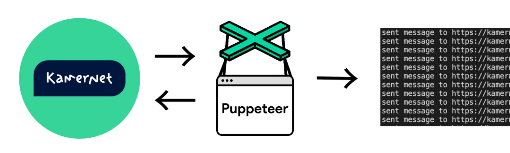

# Kamernet Puppeteer

Bot that auto-messages landlords on Kamernet so you don't have to refresh the page every 5 minutes.



## What's this about

Dutch universities don't provide housing. When I started looking on Kamernet, I quickly realized it's not me choosing a home — it's the landlord choosing me. Hundreds of people reply to each listing. Many landlords said they wanted a Dutch student, or someone who replied earlier.

Sending messages by hand was exhausting. So I wrote a Puppeteer bot that checks for new listings every 5 minutes and messages them automatically. First to reply = better chances.

## How to launch

```bash
npm install
```

1. Write your message in `message.txt` (see [advice on writing a good one](ADVICE.md#message))
2. Set up your saved search on [Kamernet](https://kamernet.nl/account/alerts)
3. Fill in your credentials in `settings.js`
4. Run it:

```bash
npm start
```

## Did it work?

I got invited to a few viewings, but the deals didn't pan out. However — through the bot I met my future best friend, who helped me get a room at their place. So yeah, it worked.

> "It is not the strongest of the students that find the room, nor the most well mannered, but the one most programmer." — Charles Darwin
